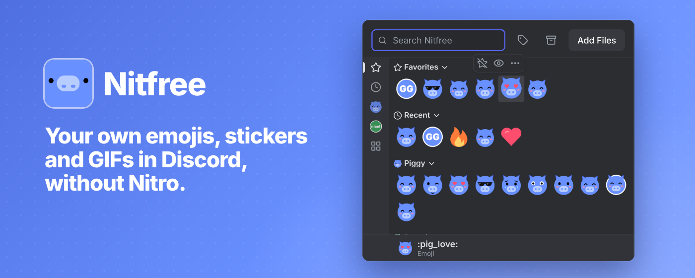
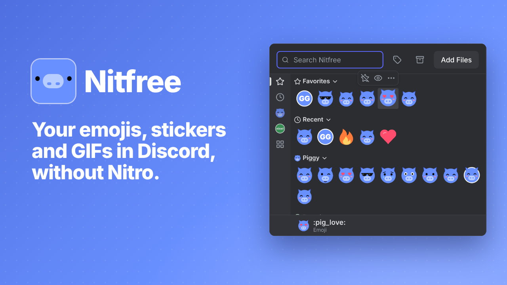
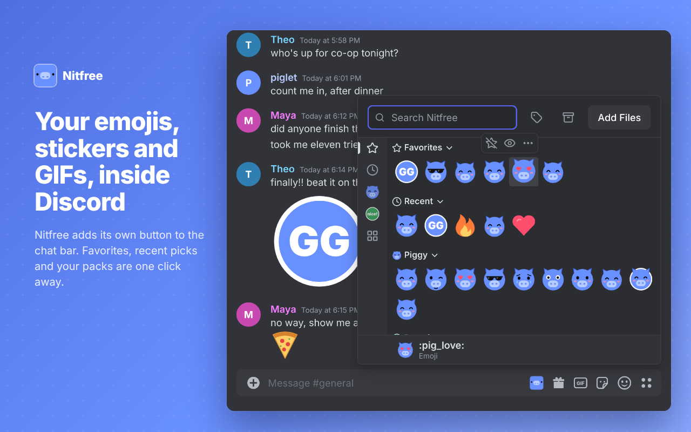
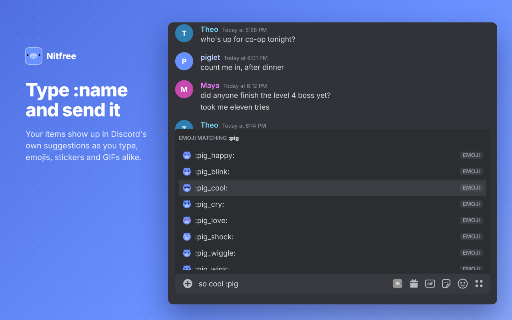
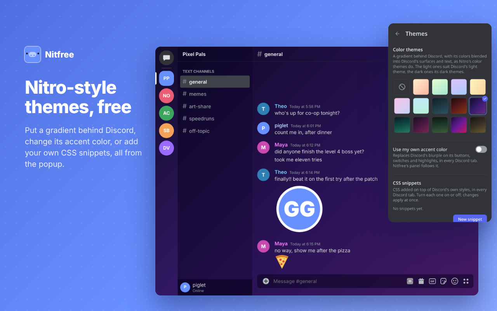
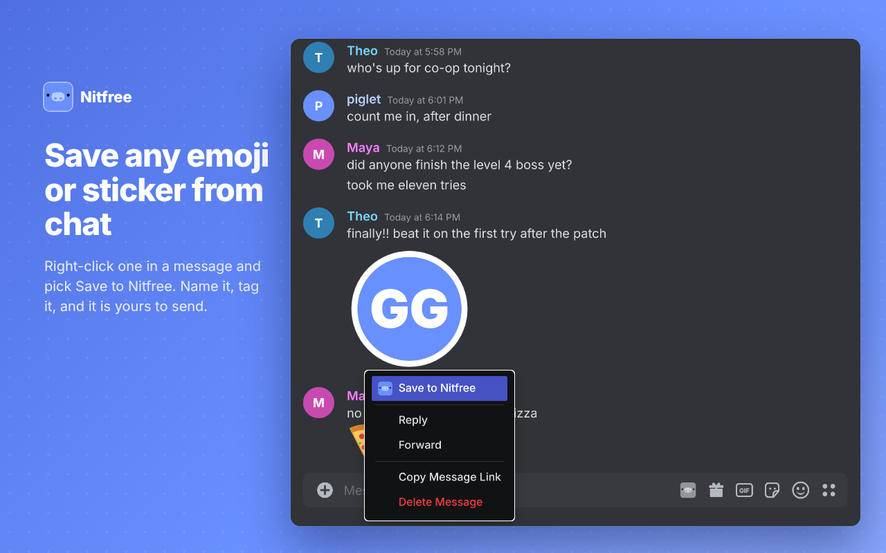
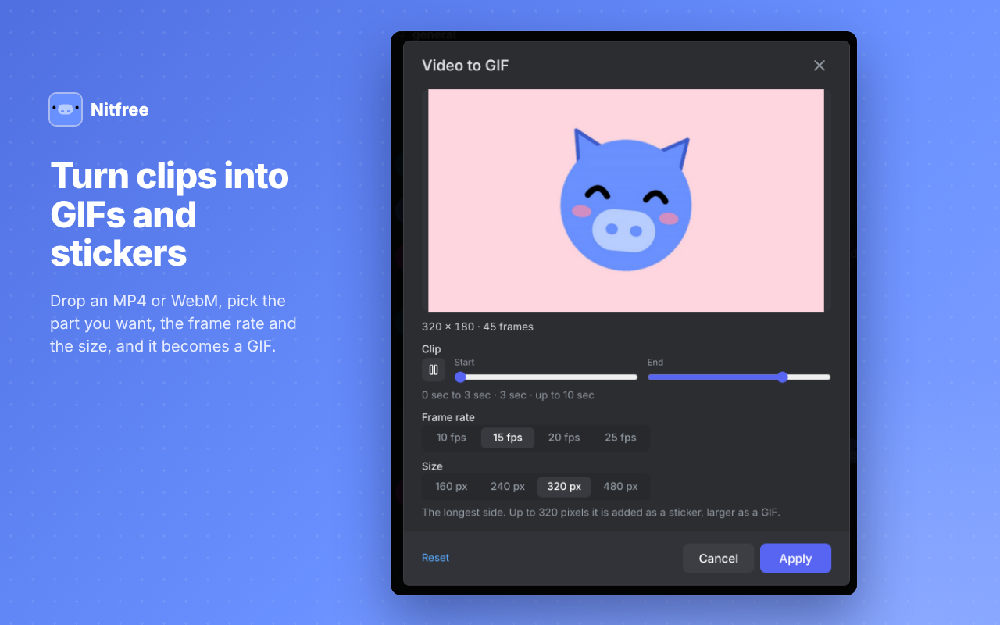
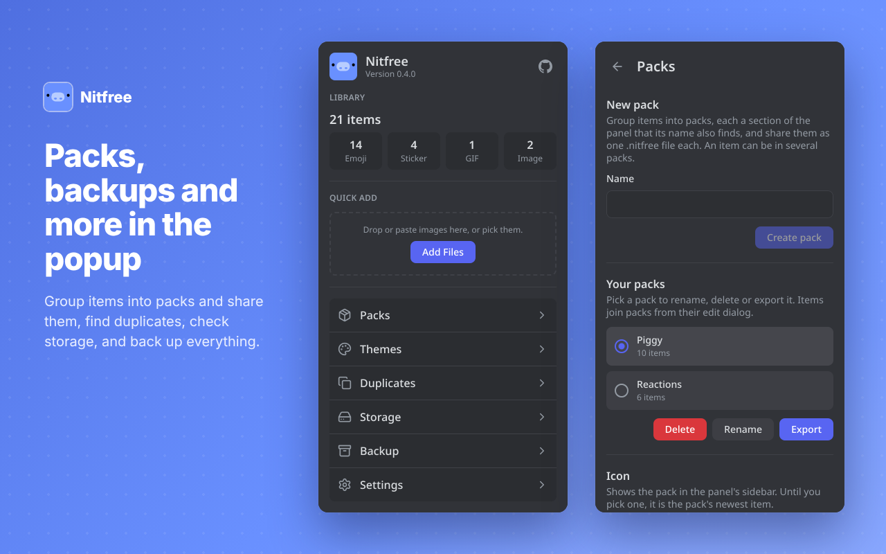

<p align="center">
  
</p>

<h1 align="center">Nitfree</h1>
<p align="center">The definitive freemium Discord Nitro alternative</p>
<p align="center"><a href="https://nitfree.ouss.es"><strong>nitfree.ouss.es</strong></a></p>

<p align="center">
  <a href="https://github.com/eoussama/nitfree/actions/workflows/ci.yml"></a>
  
  
  
</p>

<p align="center">
  
</p>

## Description

Nitfree is a quality of life extension that enhances your Discord experience by providing convenience when Nitro is too expensive for the pocket.

It keeps your own emojis, stickers, GIFs and images in a library, and lets you send them in any channel, from a button in Discord's chat bar. It works in Chrome, Edge and Firefox, in English and French.

<p align="center">
  <a href="./branding/trailer/trailer.mp4"></a>
</p>

## Features

- **Your library, inside Discord.** A Nitfree button in the chat bar, and a Nitfree tab in Discord's own expression picker. Favorites, recent picks and your packs are one click away, with search by name, description or tag.
- **Send at the right size.** Emojis and stickers are sent at the size you set, and a click either sends the item or adds it to your message, as you prefer. Press `Ctrl+Alt+N` (changeable) to open it from the keyboard.
- **Type `:name` and send it.** Your items join Discord's own emoji suggestions as you type.
- **Save from chat.** Right-click a custom emoji, sticker or image in a message and pick **Save to Nitfree**. Name it, tag it, and it is yours to send.
- **Turn clips into GIFs and stickers.** Drop an MP4 or WebM, pick the part you want, the frame rate and the size.
- **Edit images.** Crop, trim an animation's frames, or remove a background color, saved as a new item that leaves the original alone.
- **Nitro-style themes, free.** A gradient behind Discord, your own accent color, and CSS snippets, all from the popup.
- **Packs, duplicates and backup.** Group items into packs and share each as one `.nitfree` file, find duplicates and resized or converted copies, check what space the library takes, and export or import everything.
- **Private by design.** Nitfree has no servers, no analytics and no tracking. Everything stays in your browser. See the [privacy policy](PRIVACY.md).

<table>
  <tr>
    <td></td>
    <td></td>
  </tr>
  <tr>
    <td></td>
    <td></td>
  </tr>
  <tr>
    <td></td>
    <td></td>
  </tr>
</table>

## Install

Get Nitfree for Chrome, Edge or Firefox from **[nitfree.ouss.es](https://nitfree.ouss.es)**. Safari is coming soon. You can also download the zip for your browser from the [latest release](https://github.com/eoussama/nitfree/releases/latest), or build it yourself (see below).

- **Chrome and Edge:** unzip it, open `chrome://extensions` (or `edge://extensions`), turn on developer mode, choose **Load unpacked** and pick the folder.
- **Firefox:** open `about:debugging#/runtime/this-firefox` and choose **Load Temporary Add-on**, then pick the zip.

## When Discord changes

Discord updates its page often, and Nitfree depends on how its chat bar, picker and menus are built. If something stops working, open the popup, go to **Settings**, then **Run diagnostics** with a Discord tab open. It checks each part Nitfree uses and says which still work, which work only through a fallback because Discord changed something, and which are broken. **Copy report** gives you a plain text list to paste into a [bug report](https://github.com/eoussama/nitfree/issues). Nitfree's toolbar button also shows a red "!" in a tab where it cannot find something it needs.

Every place Nitfree reads Discord's markup is in [`src/lib/discord/selectors.ts`](src/lib/discord/selectors.ts), so a Discord update is usually a one-file fix.

## Development

Requires Node.js 22 or later and pnpm.

```bash
pnpm install
pnpm dev            # Chrome with hot reload
pnpm dev:firefox    # Firefox with hot reload
```

| Script                                                         | Description                               |
| -------------------------------------------------------------- | ----------------------------------------- |
| `pnpm build`, `build:firefox`, `build:edge`                    | Production build in `.output/`            |
| `pnpm zip`, `zip:firefox`, `zip:edge`                          | Zip per browser                           |
| `pnpm lint`, `pnpm lint:fix`                                   | Lint with `@eoussama/dx`                  |
| `pnpm typecheck`                                               | Type check TypeScript and Svelte files    |
| `pnpm test`, `pnpm test:coverage`                              | Unit tests with Vitest, and with coverage |
| `pnpm test:mutation`                                           | Mutation tests with Stryker               |
| `pnpm test:e2e`                                                | Load the Chrome build in Chromium with Playwright (run `pnpm build` and `pnpm exec playwright install chromium` first) |
| `pnpm check`                                                   | Audit, lint, type check, every build, coverage and end-to-end tests, in one go |
| `pnpm site`                                                    | Build the landing page in `.output/site`  |

The previous Vue implementation lives on the `legacy` branch.

### Landing page

The landing page at [nitfree.ouss.es](https://nitfree.ouss.es) lives in [`site/`](site/), with its screenshots and trailer taken from [`branding/`](branding/). `pnpm site` builds it with the version from `package.json`. Each release deploys it to GitHub Pages, after the release itself (see [`site.yml`](.github/workflows/site.yml)), and it can also be deployed by hand from the Actions tab.

Its buttons point to each browser's store once its link is set in [`site/stores.json`](site/stores.json) (`chrome`, `edge`, `firefox` and `safari`), and show "Coming soon" until then. The trailer plays from YouTube, loaded only once it is played.

## Contributing

Issues and pull requests are welcome. Read [CONTRIBUTING.md](CONTRIBUTING.md) and the [code of conduct](CODE_OF_CONDUCT.md) first, and report security problems as described in [SECURITY.md](SECURITY.md).

## License

Nitfree is released under the [MIT license](LICENSE).
